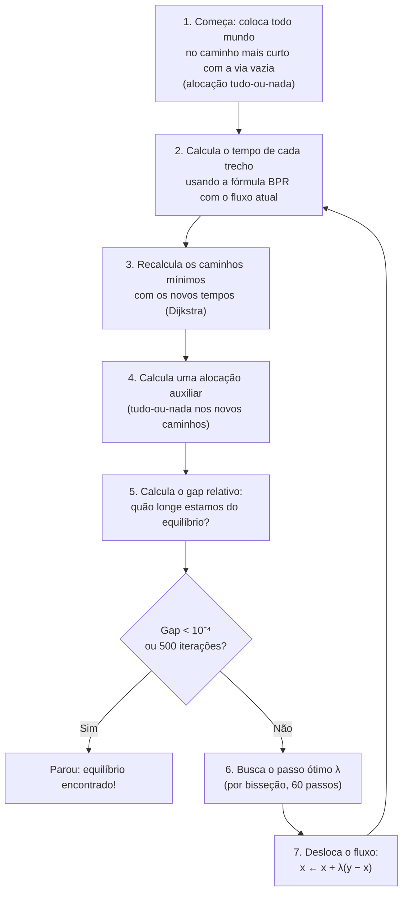
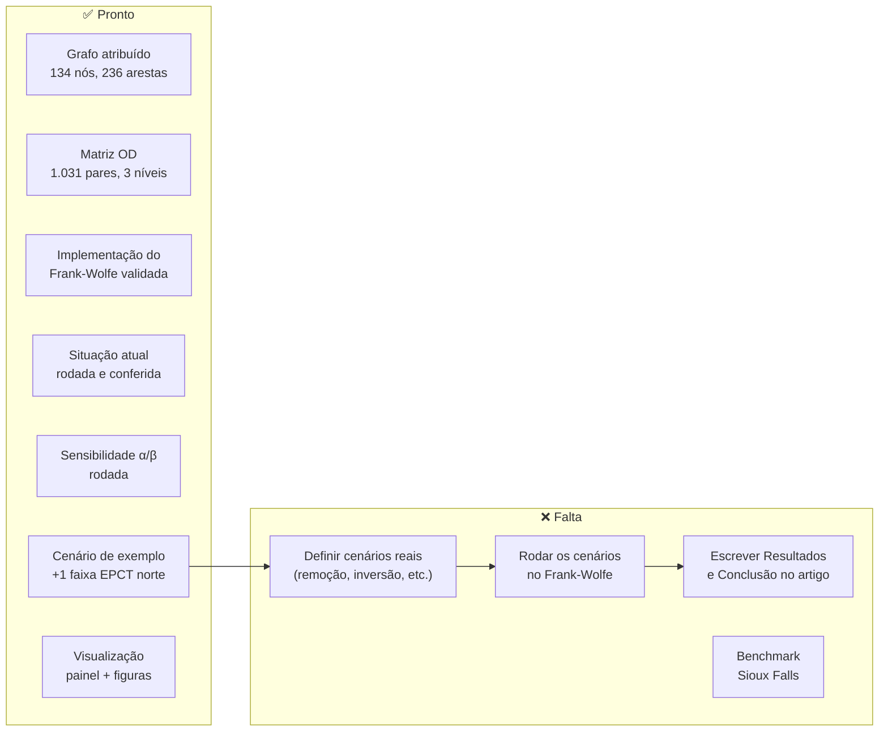

# Como o Frank-Wolfe foi aplicado e o que os resultados mostram

> [!NOTE]
> Este documento explica, passo a passo e em linguagem narrativa, tudo o que o repositório fez com o algoritmo de Frank-Wolfe: o que ele é, como foi implementado, como foi validado, o que ele calculou e o que os números significam.

---

## 1. O que o Frank-Wolfe faz — e por que vocês precisam dele

Imagina que existem 8.309 carros por hora querendo ir de vários pontos a outros numa malha viária. Cada motorista, individualmente, escolhe o caminho mais rápido **pra ele**. Mas à medida que mais gente escolhe a mesma rota, essa rota fica mais lenta (porque enche). Então o "caminho mais rápido" muda. É como se fosse um jogo de estratégia em que todo mundo recalcula seu caminho ao mesmo tempo.

O **Equilíbrio de Wardrop** é o ponto em que ninguém mais consegue melhorar seu tempo mudando de rota — como se o trânsito tivesse "assentado". O **algoritmo de Frank-Wolfe** é o método matemático que encontra esse ponto de equilíbrio. Ele foi publicado originalmente em 1956 e adaptado para trânsito por LeBlanc, Morlok e Pierskalla em 1975.

Na prática, o Frank-Wolfe responde à pergunta: **"dado que essa quantidade de carros quer ir desses pontos a esses outros, qual rota cada um vai pegar e quão lenta vai ficar cada via?"**

---

## 2. O que o Frank-Wolfe precisa como entrada

Antes de rodar o algoritmo, foi preciso montar três coisas:

### 2.1 O grafo (a "mapa" das ruas)

O grafo é um modelo da malha viária: 134 pontos (nós) conectados por 236 trechos de via (arestas). Foi extraído do OpenStreetMap na região do trevo entre a EPCT, EPIP e DF-480, no Gama. Cada aresta tem direção (porque as vias têm sentido de circulação) e carrega as seguintes informações:

| Atributo | O que é | De onde veio |
|---|---|---|
| `t0_min` | Tempo pra percorrer o trecho **com a via completamente vazia** (em minutos) | Velocidade de madrugada (TomTom, 0h–4h) |
| `capacidade_veic_h` | Quantos carros **por hora** cabem passando naquele trecho | Nº de faixas × capacidade por faixa da literatura; nos 25 gargalos, ajustada para reproduzir o tempo real |
| `limite_kmh` | Velocidade máxima permitida | OSM + Código de Trânsito Brasileiro |
| `lanes_sentido` | Nº de faixas por sentido | OSM |

### 2.2 A matriz de demanda (quem quer ir pra onde)

A TomTom O/D Analysis forneceu as viagens reais de GPS: 15.429 viagens em 22 dias úteis de julho de 2026, das 18h às 19h. Dessas, restaram 14.960 viagens alocáveis em 1.031 pares origem-destino. Como a TomTom só vê uma fração dos carros reais (quem tem o app dela), foi aplicado um **fator de expansão** para converter "viagens da amostra" em "carros reais". Esse fator foi calibrado cruzando a amostra com os contadores automáticos do DER-DF.

O problema é que o fator variou muito entre os 4 pontos de calibração:

| Pista | Fator |
|---|---|
| EPCT decrescente | 21,96 |
| DF-480 decrescente | 14,35 |
| DF-480 crescente | 10,08 |
| EPCT crescente | 8,82 |

Não dá pra saber qual é o "verdadeiro". Por isso, **toda simulação roda com três hipóteses de demanda**:

| Hipótese | Fator | Carros/hora totais |
|---|---|---|
| Demanda **baixa** | 8,82 | ~6.000 |
| Demanda **adotada** (mediana) | 12,21 | ~8.309 |
| Demanda **alta** | 21,96 | ~14.944 |

### 2.3 A fórmula de atraso (BPR)

É a fórmula que diz **quanto mais lento** fica um trecho quando passa mais gente por ele:

$$t(x) = t_0 \times \left(1 + \alpha \times \left(\frac{x}{c}\right)^{\beta}\right)$$

Onde:
- \(t_0\) = tempo com a via vazia
- \(x\) = fluxo de veículos naquele trecho
- \(c\) = capacidade do trecho
- \(\alpha = 0{,}15\) e \(\beta = 4\) = parâmetros clássicos (caso-base)

A fórmula diz, por exemplo, que quando a via está a 100% da capacidade, o tempo sobe 15%. Quando está a 120%, sobe 31%. A **quarta potência** faz com que a coisa exploda rapidamente quando se ultrapassa a capacidade.

---

## 3. O que o algoritmo faz, passo a passo

A implementação está em [`scripts/frank_wolfe.py`](file:///d:/Projetos_UnB/Semestre_6/Projeto-LimpaRuas/scripts/frank_wolfe.py). O algoritmo funciona assim:

Em português ainda mais simples:

1. **Primeiro chute:** todo mundo pega o caminho mais rápido como se as ruas estivessem vazias. Isso sobrecarrega brutalmente as rodovias principais.
2. **Recalcula os tempos:** com todo mundo naquelas ruas, elas ficam lentíssimas.
3. **Recalcula os melhores caminhos:** agora, com as ruas principais travadas, caminhos alternativos podem ser mais rápidos.
4. **Mistura:** o algoritmo não joga todo mundo pro novo caminho (senão voltaria ao problema). Ele **desloca uma fração** do fluxo na direção do novo caminho, encontrando a fração ótima (o passo λ) por busca linear.
5. **Repete** até que o sistema esteja tão perto do equilíbrio que ninguém mais ganha nada mudando de rota (gap < 0,0001).

### O gap relativo — medindo "quão equilibrado" está

O **gap** é a diferença entre o tempo total que o sistema está gastando e o tempo que gastaria se cada motorista já estivesse no caminho ideal. Quando o gap cai abaixo de 10⁻⁴ (0,01%), consideramos que o equilíbrio foi atingido.

---

## 4. Validação: como sabem que o algoritmo funciona?

Antes de usar o Frank-Wolfe na malha real, ele foi testado em problemas com solução conhecida. Os testes estão na função `testes()` do [`frank_wolfe.py`](file:///d:/Projetos_UnB/Semestre_6/Projeto-LimpaRuas/scripts/frank_wolfe.py#L524-L580):

| Teste | O que verifica | Esperado | Obtido |
|---|---|---|---|
| **Rede de Braess sem a ponte** | Equilíbrio simétrico em 2 rotas paralelas | 3 veículos em cada rota, custo 83 | ✅ 3,0 / 3,0, custo 83,000 |
| **Rede de Braess com a ponte** | O Paradoxo de Braess: adicionar uma via piora o sistema | Fluxos [4,2,2,4,2], custo 92, TSTT sobe de 498→552 | ✅ Exato |
| **Duas rotas com BPR** | Igualdade de custos no equilíbrio | 1.426,9 veíc/h na rota 1 | ✅ 1.426,9 |
| **Gama, demanda alta** | A função-objetivo de Beckmann nunca cresce entre iterações | Monótona | ✅ Ok (28 iterações) |
| **Gama, demanda alta** | Conservação de fluxo (nenhum carro some ou aparece do nada) | Saldo zero em todo nó | ✅ Desvio máximo: 4×10⁻¹² veíc/h |

Todos os testes passaram. O algoritmo está correto.

---

## 5. Resultados da situação atual (sem intervenção)

Ao rodar `python scripts/frank_wolfe.py`, o algoritmo resolve o equilíbrio para a malha como ela é hoje, nos três níveis de demanda. Os resultados estão em [`resultados/base/resumo.json`](file:///d:/Projetos_UnB/Semestre_6/Projeto-LimpaRuas/resultados/base/resumo.json).

### 5.1 Convergência

| Demanda | Iterações | Gap final | Tempo de cálculo |
|---|---|---|---|
| Baixa (8,82) | 2 | 3,5 × 10⁻¹⁶ | 0,21 s |
| Adotada (12,21) | 4 | 3,1 × 10⁻⁹ | 0,34 s |
| Alta (21,96) | 28 | 10⁻⁴ | 2,23 s |

Repare: com pouca demanda, o equilíbrio é fácil de achar (poucos carros, pouca disputa). Com muita demanda, o algoritmo precisa de mais iterações porque as interações entre as rotas são mais complexas. Na demanda alta, aparece o **zigue-zague típico** do Frank-Wolfe perto do ótimo (o gap oscila ao redor do critério de parada).

### 5.2 Indicadores do sistema

| Indicador | Demanda baixa | Demanda adotada | Demanda alta |
|---|---|---|---|
| Veículos/hora | 6.002 | 8.309 | 14.944 |
| **TSTT (tempo total do sistema)** | 343,4 veíc·h | 476,9 veíc·h | 884,4 veíc·h |
| **K da rede** (ponderado por veíc·km) | 0,703 | 0,700 | 0,676 |
| Velocidade média da rede | 45,2 km/h | 45,1 km/h | 43,7 km/h |
| Tempo médio de viagem | 3,43 min | 3,44 min | 3,55 min |
| Arestas com V/C > 1 (sobrecarregadas) | 20 | 20 | 26 |
| Arestas com K < 0,5 (congestionadas) | 67 | 67 | 68 |

**O que isso significa em português:**
- O **TSTT** é a soma do tempo que todos os veículos gastam na rede. É a "conta" total de tempo do sistema. 476,9 veíc·h significa que, se você somasse os minutos de todos os 8.309 carros, daria 476,9 horas.
- O **K da rede** é a razão entre a velocidade real e a velocidade máxima permitida, ponderada por veículo·km. Um K de 0,70 significa que, em média, os carros andam a 70% do limite. Quanto mais perto de 1, mais "livre" está o trânsito.
- As **20 arestas com V/C > 1** são os gargalos calibrados — ali, o fluxo estimado já supera a capacidade efetiva, reproduzindo as filas reais do trevo.

### 5.3 Conferência com dados reais (demanda adotada)

O modelo foi **conferido** (não validado independentemente — a diferença importa) de três formas:

| Comparação | O que testa | Resultado |
|---|---|---|
| Fluxo modelado × passagens TomTom (40 arestas isoladas) | Se os carros "escolhem as mesmas rotas" no modelo e na realidade | Correlação **0,93**; modelo/observado **0,94** (mediana); GEH mediano **3,5** (60% abaixo de 5, que é o critério de aceitação da prática) |
| Tempo modelado × observado (130 arestas não calibradas) | Se a fórmula BPR + t₀ reproduzem os tempos reais | Modelo/observado **0,91** (mediana) — o modelo é ~9% mais rápido que a realidade, sobretudo nas terciárias, onde o atraso de cruzamento não depende do volume |
| Tempo total ponderado pelo fluxo | Aderência global | Modelo/observado **0,972** — muito perto da realidade |
| Tempo nas 104 arestas calibradas | Nada (por construção devem dar 1,00) | **1,00** ✅ |

> [!IMPORTANT]
> Não é validação independente. As passagens vêm da mesma amostra TomTom que gerou a matriz. Os contadores do DETRAN calibram o fator de expansão. O tempo observado calibra os gargalos. O documento [`problemas_do_modelo.md`](file:///d:/Projetos_UnB/Semestre_6/Projeto-LimpaRuas/research/problemas_do_modelo.md) explica isso em detalhe no Problema 2.

---

## 6. A análise de sensibilidade: e se a fórmula for outra?

Também foi rodada uma variante com α=0,8 e β=4,7 (parâmetros mais agressivos), em [`resultados/base_a0.8_b4.7/`](file:///d:/Projetos_UnB/Semestre_6/Projeto-LimpaRuas/resultados/base_a0.8_b4.7/resumo.json). Nessa variante, a fórmula BPR penaliza muito mais a saturação.

| Demanda | TSTT (α=0,15/β=4) | TSTT (α=0,8/β=4,7) | Diferença | Iterações |
|---|---|---|---|---|
| Baixa | 343,4 veíc·h | 344,0 veíc·h | +0,2% | 2 |
| Adotada | 476,9 veíc·h | 480,4 veíc·h | +0,7% | 4 |
| **Alta** | **884,4 veíc·h** | **1.166,6 veíc·h** | **+32%** | **190** |

**O que isso mostra:** com pouca demanda, os parâmetros da fórmula quase não importam. Com muita demanda, eles importam **demais**. A fórmula mais agressiva faz o congestionamento explodir na demanda alta (o K da rede cai de 0,676 para 0,51 — quase metade do limite), e o Frank-Wolfe precisa de 190 iterações em vez de 28. Conclusão: α e β pesam justamente nos cenários que mais interessam.

---

## 7. O cenário de exemplo: +1 faixa na EPCT sentido norte

Foi rodado **um** cenário-exemplo ([`cenarios/exemplo_faixa_epct_norte.json`](file:///d:/Projetos_UnB/Semestre_6/Projeto-LimpaRuas/cenarios/exemplo_faixa_epct_norte.json)): adicionar 1 faixa em 5 trechos de gargalo da EPCT sentido norte, antes do trevo (arestas 132→133, 133→63, 63→102, 102→126, 126→60). Resultados em [`resultados/exemplo_faixa_epct_norte/`](file:///d:/Projetos_UnB/Semestre_6/Projeto-LimpaRuas/resultados/exemplo_faixa_epct_norte/resumo.json).

### 7.1 Impacto no tempo total do sistema (TSTT)

| Demanda | TSTT base | TSTT cenário | Δ TSTT | Variação |
|---|---|---|---|---|
| Baixa | 343,4 veíc·h | 313,9 veíc·h | −29,5 veíc·h | **−8,59%** |
| Adotada | 476,9 veíc·h | 436,1 veíc·h | −40,9 veíc·h | **−8,57%** |
| Alta | 884,4 veíc·h | 810,8 veíc·h | −73,6 veíc·h | **−8,32%** |

**Em português:** adicionar uma faixa na EPCT norte economizou ~8,5% do tempo total do sistema, **nos três níveis de demanda**. É uma conclusão **robusta** (vale para qualquer hipótese de fator de expansão).

### 7.2 Impacto no K da rede

| Demanda | K base | K cenário | Δ K |
|---|---|---|---|
| Baixa | 0,703 | 0,726 | +0,024 |
| Adotada | 0,700 | 0,724 | +0,024 |
| Alta | 0,676 | 0,700 | +0,024 |

O K subiu ~0,024 em todos os níveis, o que significa que, em média, os carros agora andam mais perto do limite de velocidade.

### 7.3 O que aconteceu nos trechos alterados

As maiores mudanças de K foram exatamente nas arestas que receberam a faixa:

| Aresta | Δ K |
|---|---|
| 133→63 | **+0,332** (K subiu de ~0,29 para ~0,62!) |
| 132→133 | **+0,221** |

Esses são os trechos mais congestionados do trevo. Receber uma faixa extra fez a capacidade efetiva crescer proporcionalmente, e o K saltou de "praticamente parado" para "fluxo moderado".

### 7.4 Redistribuição de fluxo

Na demanda adotada, as maiores mudanças de fluxo foram:

| Aresta | Δ fluxo (veíc/h) | O que significa |
|---|---|---|
| 64→66 | **+6,1** | Mais carros entrando na EPCT norte (que agora é mais rápida) |
| 8→16 | +5,0 | Rota alternativa que alimenta a EPCT |
| 124→64 / 16→106 / 106→124 | +4,5 | Trechos de acesso à EPCT norte |
| 68→73 / 8→68 / 73→67 / 67→66 | **−2,8** | Rota alternativa que PERDEU fluxo (carros voltaram à EPCT) |

**Interpretação:** a faixa extra tornou a EPCT norte mais atrativa. Carros que antes desviavam por rotas alternativas (por conta do congestionamento) voltaram para a rodovia. É o comportamento esperado pelo equilíbrio de Wardrop: quando uma rota melhora, ela atrai fluxo de volta até os tempos se reequilibrarem.

### 7.5 E o Paradoxo de Braess?

**Não foi observado neste cenário.** O K subiu na via-alvo e o TSTT caiu — o sistema melhorou como um todo. Para encontrar o Paradoxo de Braess, é preciso testar cenários de **remoção** de arestas (fechamento de via) e verificar se o TSTT diminui, ou cenários de **adição** em que o TSTT piora.

> [!WARNING]
> Este é um **exemplo de sintaxe**, não um cenário real escolhido para o artigo. A descrição dele no JSON diz exatamente isso: *"EXEMPLO DE SINTAXE, nao e um cenario escolhido"*. Os cenários reais (remoção de arestas, inversão de sentido, intervenções na malha interna) **ainda precisam ser definidos e rodados**.

---

## 8. Por que as conclusões são quase iguais nos três níveis?

A variação percentual do TSTT foi −8,59%, −8,57% e −8,32% — quase idêntica. Isso acontece porque a intervenção foi nos **gargalos calibrados**, cuja capacidade efetiva escala com o fator de expansão. Como o fator multiplica tanto o fluxo quanto a capacidade na mesma proporção, a razão V/C nesses trechos é a mesma nos três níveis. Cada nível é um "mundo" coerente que reproduz os tempos observados com aquela demanda.

A diferença entre os níveis aparece **nas arestas não calibradas** (onde a capacidade é a nominal e não escala com o fator). Na demanda alta, essas arestas ficam mais carregadas, o que muda ligeiramente o padrão de redistribuição.

O [`problemas_do_modelo.md`](file:///d:/Projetos_UnB/Semestre_6/Projeto-LimpaRuas/research/problemas_do_modelo.md), Problema 3, documenta essa nuance e diz que o artigo deve declarar que uma conclusão "robusta" sobre gargalos é, em parte, robusta por construção.

---

## 9. O que foi gerado pelo script

O [`frank_wolfe.py`](file:///d:/Projetos_UnB/Semestre_6/Projeto-LimpaRuas/scripts/frank_wolfe.py) gera os seguintes arquivos por rodada:

| Arquivo | Conteúdo |
|---|---|
| `resultados/<rodada>/arestas_baixa.csv` | Fluxo, tempo, V/C, velocidade e K modelados por aresta, demanda baixa |
| `resultados/<rodada>/arestas_adotada.csv` | Idem, demanda adotada |
| `resultados/<rodada>/arestas_alta.csv` | Idem, demanda alta |
| `resultados/<rodada>/resumo.json` | TSTT, gap, iterações, convergência, conferências, deltas vs base |

E o [`visualizar_resultados.py`](file:///d:/Projetos_UnB/Semestre_6/Projeto-LimpaRuas/scripts/visualizar_resultados.py) gera:
- `resultados/painel.html` — painel interativo com mapa, gráficos e tabelas
- `resultados/figuras/*.png` — figuras estáticas para o artigo (convergência, mapas de K e V/C, tempo modelado × observado, Δ fluxo)

---

## 10. Resumo do que está pronto e do que falta

